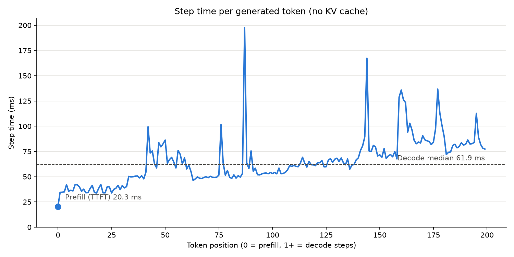
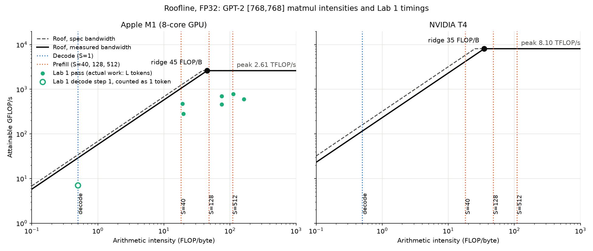
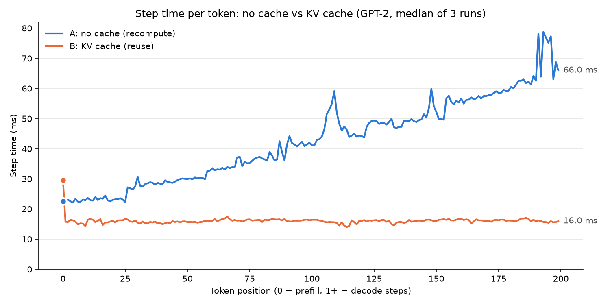

# LLM Inference Engineering Hands-on Labs

A series of from-scratch experiments into how large language models actually run at inference time: where the time goes, why, and how serving systems make it faster. Each lab measures something on real hardware, explains the result from first principles (memory bandwidth, FLOPs, attention cost), and is written up as a short report.

**Stack:** Python · PyTorch · Hugging Face Transformers · Apple Silicon GPU (MPS) · NVIDIA T4 (Kaggle) · matplotlib

## Labs

| # | Lab | What I did | Key finding |
|---|-----|------------|-------------|
| 1 | [Prefill vs Decode (no KV cache)](labs/01-prefill-vs-decode/) | Wrote GPT-2's autoregressive generation loop by hand (no model.generate()), timed every forward pass with GPU sync, and compared 39- vs 156-token prompts | Without a KV cache, decode cost grows with sequence length (~35 ms to ~80 ms per token over 200 steps); a 4× longer prompt raised prefill only 2.75×, which points to a fixed per-pass cost from reading the weights |
| 2 | [Roofline: M1 vs T4](labs/02-roofline/) | Measured effective memory bandwidth on an M1 and a T4, derived the arithmetic intensity of GPT-2's [768,768] matmul by hand and in code, drew both rooflines, and placed the Lab 1 timings on the M1 roofline | Decode (0.5 FLOP/byte in FP32) sits ~90× below the M1's ridge, so at best it uses ~1% of peak compute; Lab 1's measured decode reaches only ~25% of even that memory-bound ceiling |
| 3 | [KV Cache](labs/03-kv-cache/) | Added a KV cache to the hand-written loop (passing past_key_values back each step), timed cached vs uncached decode side by side, and measured the cache size from its tensors and from the formula | The cache flattens decode at ~16 ms per token (4.1× faster than no cache at token 200 and the gap keeps growing). It costs exactly 72 KB per token in FP32 (36 KB in FP16), and it leaves decode still memory-bound |

*More labs coming: GPU profiling, batching, quantization.*

## Highlights

### Lab 1: Prefill vs Decode



- **Measured correctly:** synchronized the GPU before stopping each timer (MPS runs asynchronously) and excluded one-time kernel setup with a warm-up pass
- **Checked correctness:** the hand-written decode loop produces the same output as model.generate() with greedy decoding
- **Explained the numbers:** back-of-envelope roofline estimate (~7 ms weight reads at 68 GB/s vs ~15 ms of compute at ~2.6 TFLOPS) to explain why prefill scales sub-linearly
- **Recorded open questions:** an unexplained slowdown at decode step 1, and hypotheses to test with a profiler in later labs

### Lab 2: Roofline



| | M1 (8-core GPU) | T4 |
|---|---|---|
| Peak FP32 | 2.61 TFLOPS | 8.1 TFLOPS |
| Bandwidth, spec → measured | 68.3 → 57.79 GB/s (85%) | 320 → 231.27 GB/s (72%) |
| Ridge point (measured) | 45.2 FLOP/B | 35.0 FLOP/B |

- **Measured, not guessed:** a 1 GB copy benchmark (median of 5 × 50 copies) gave 72–85% of spec bandwidth, after fixing GB vs GiB and allocation-in-the-loop mistakes
- **Derived the intensities:** ~1 FLOP/byte for decode and ~S for prefill (FP16), and showed that "~S" breaks down once the activations are bigger than the weights (only 0.43·S at S = 512)
- **Closed the loop with Lab 1:** a decode step took 35 ms where reading the weights should take 8.6 ms; without a KV cache each "decode" step is really prefill-sized work, and every point sits at 18–43% of its roof
- **Two ridges:** in FP32 the T4 becomes compute-bound first, but with FP16 tensor cores (65 TFLOPS) its ridge jumps to ~281 FLOP/B, so S = 128 is compute-bound on the M1 and still memory-bound on the T4

### Lab 3: KV Cache



| | No cache | KV cache |
|---|---|---|
| Decode median | 42.49 ms | 16.08 ms |
| Last step (token 200) | 65.99 ms | 15.97 ms (**4.1×** faster) |
| Whole 200-token generation | ~8.5 s | ~3.2 s |
| Memory cost | none | 72 KB per token (FP32), 17.5 MB at 238 tokens |

- **Store instead of recompute:** without a cache, every step recomputes keys and values for all earlier tokens, so step time climbs. With a cache, those are reused and only the new token is processed, so it stays flat.
- **Checked correctness:** the cached and uncached loops generate identical tokens (greedy). The measured cache size (summing the K and V tensor bytes across all 12 layers) matches 2 × L × d_model × bytes to the byte.
- **Explained the 36 KB vs 72 KB gap:** the textbook number assumes FP16. My model runs in FP32, so it's exactly double.
- **Scaled it up:** a 70B-style model with 32 users at 4k context would need ~344 GB of KV cache, more than its 140 GB of weights (~43 GB with grouped-query attention). That's why memory, not compute, limits how many users a GPU can serve.
- **Closing the loop with Lab 2:** the cache made decode faster by removing compute, which leaves it *more* memory-bound (0.5 FLOP/B). Its 16 ms step reaches ~54% of the memory-bound roof, up from ~25% in Lab 1. Fixing the warm-up to cover both loops also made Lab 1's "slow first decode step" anomaly disappear.

## Repository layout

```
.
├── labs/
│   ├── 01-prefill-vs-decode/
│   │   ├── README.md                # summary, results, how to run
│   │   ├── profile_no_cache.py      # experiment code
│   │   ├── report.pdf               # full write-up
│   │   └── results/                 # plots and terminal output
│   ├── 02-roofline/
│   │   ├── README.md                # hardware numbers, intensities, findings
│   │   ├── measure_bandwidth.py     # effective memory bandwidth (MPS or CUDA)
│   │   ├── arithmetic_intensity.py  # [768,768] matmul intensity, FP16 vs FP32
│   │   ├── roofline.py              # ridge points, roofline plot, Lab 1 comparison
│   │   ├── report.pdf               # full write-up
│   │   └── results/                 # plots and terminal output
│   └── 03-kv-cache/
│       ├── README.md                # what a KV cache is, timing, memory, findings
│       ├── kv_cache.py              # cached vs uncached loops, timing, cache size
│       ├── report.pdf               # full write-up
│       └── results/                 # step-time and cache-size plots
├── docs/                            # course plan and reference material
└── requirements.txt
```

## Running the labs

```bash
python -m venv .venv && source .venv/bin/activate
pip install -r requirements.txt
python labs/01-prefill-vs-decode/profile_no_cache.py
python labs/02-roofline/measure_bandwidth.py
python labs/02-roofline/arithmetic_intensity.py
python labs/02-roofline/roofline.py
python labs/03-kv-cache/kv_cache.py
```

Runs on Apple Silicon (MPS) and falls back to CPU otherwise. `measure_bandwidth.py` also runs on CUDA (the T4 numbers came from Kaggle).
