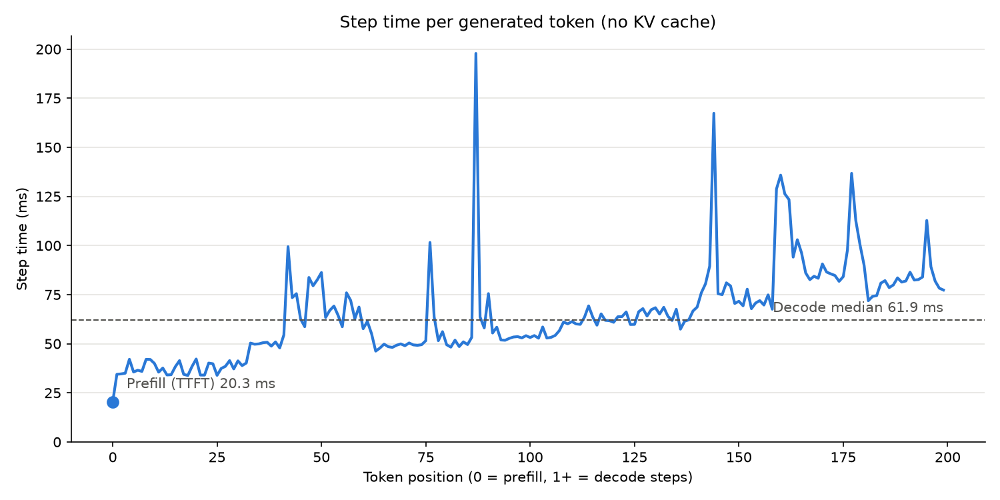
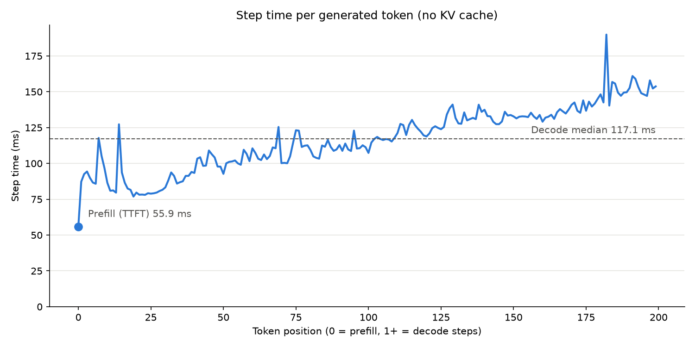

# Lab 1 — GPT-2 Inference Profiling: Prefill vs Decode (no KV cache)

**Full write-up:** [report.pdf](report.pdf) · **Code:** [profile_no_cache.py](profile_no_cache.py)

## Goal

Run GPT-2 inference by hand, without `model.generate()`, and time every forward pass to see the prefill/decode split in real numbers.

**Hypothesis:** without a KV cache, every decode step reprocesses the whole sequence, so each decode step should be slower than prefill and keep getting slower as the sequence grows.

## Setup

| | |
|---|---|
| Model | GPT-2 small (124M params), fp32 |
| Hardware | Apple M1, MPS backend |
| Decoding | Greedy, batch size 1, 200 new tokens, no KV cache |
| Timing | `time.perf_counter()` per step, `torch.mps.synchronize()` before stopping the clock, one untimed warm-up pass |
| Validation | Output matches `model.generate()` (greedy) exactly |

## Results

| Prompt | Prefill (TTFT) | Decode median | Decode step 1 | Last decode step |
|---|---|---|---|---|
| 39 tokens | 20.35 ms | 61.91 ms | ~35 ms | ~78 ms |
| 156 tokens (4×) | 55.92 ms | 117.08 ms | ~87 ms | ~154 ms |

| 39-token prompt | 156-token prompt |
|---|---|
|  |  |

## Takeaways

- **Decode time grows with sequence length.** Recomputing keys and values for every earlier token makes per-step cost roughly double over 200 steps. A KV cache removes this wasted work.
- **Time grows more slowly than token count** (~2× the time for ~6× the tokens). Each pass has a fixed cost: reading ~500 MB of weights.
- **A 4× longer prompt makes prefill only 2.75× slower.** A roofline estimate (~7 ms memory vs ~15 ms compute at 156 tokens) suggests the bottleneck shifts from memory to compute somewhere in this range.
- **Anomaly:** decode step 1 is ~70% slower than prefill despite having only one more token. My guess is that MPS prepares kernels for each input shape and the warm-up only covered the prompt's shape. To be tested.

## Run

```bash
python profile_no_cache.py
```

Prints the generated text and the timing summary, and saves the step-time plot to `results/step_time_no_cache.png`.
