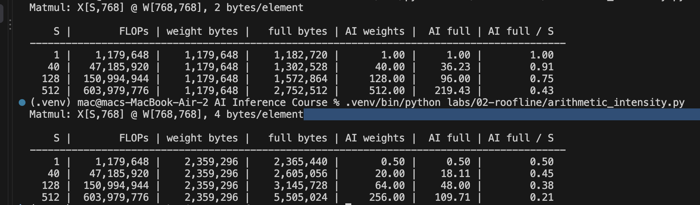
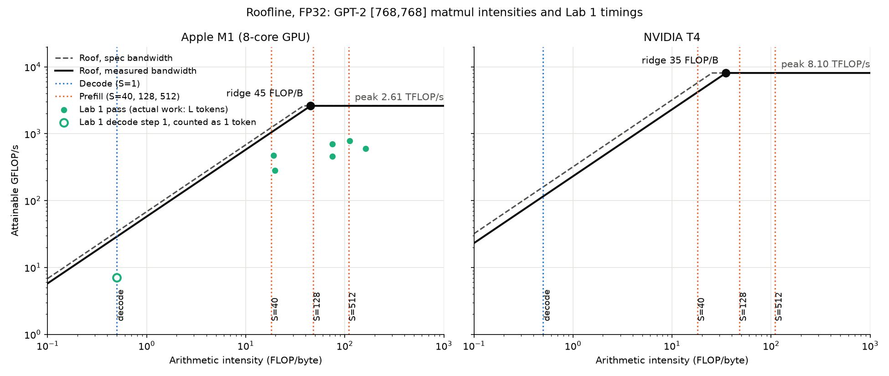

# Lab 2: M1 and T4 rooflines
1 GB FP32 copy, median of 5 runs × 50 copies, M1 local, T4 on Kaggle using one GPU

|  | M1 | T4 |
| --- | --- | --- |
| GPU cores | 8  | 40 |
| Peak FLOP/s | 2.61 TFLOPS FP32 | 8.1 TFLOPS FP32 |
| Spec bandwidth | 68.3 GB/s | 320 GB/s |
| Measured bandwidth | 57.79 GB/s | 231.27 GB/s |
| Measured / spec | 84.61% | 72.27% |

## Ridge points (FP32)

Ridge point = peak FLOP/s ÷ bandwidth. Kernels below it are memory-bound; above it, compute-bound.

| | M1 | T4 |
| --- | --- | --- |
| Ridge, spec bandwidth | 38.2 FLOP/B | 25.3 FLOP/B |
| Ridge, measured bandwidth | 45.2 FLOP/B | 35.0 FLOP/B |

The measured bandwidth is lower than spec, so the ridge moves right: in practice, a kernel needs more intensity before it becomes compute-bound.

## Arithmetic intensity of GPT-2's [768,768] matmul

`Y[S,768] = X[S,768] @ W[768,768]` ([arithmetic_intensity.py](arithmetic_intensity.py))

- FLOPs = 2·S·d², weight bytes = b·d², so counting weights only gives intensity = S·(2/b): **1 FLOP/B for decode and S for prefill in FP16**, half that in FP32.
- Counting the activations too, bytes = b·d²·(1 + 2S/d), so the real intensity is S/(1 + 2S/d). "≈S" holds only while S ≪ d/2 = 384. At S = 512 you get 0.43·S.



## Roofline

([roofline.py](roofline.py)) FP32 on both machines, with decode (S=1) and prefill (S=40, 128, 512) as vertical markers. Intensities use full bytes (X + W + Y).



- **Decode (0.5 FLOP/B) is far below both ridges** (~90× below on the M1). It is deeply memory-bound on both machines.
- **Prefill crosses the ridge around S ≈ 128 on the M1** and earlier on the T4 (lower ridge).

## Closing the loop with Lab 1

Achieved FLOP/s = FLOPs per step ÷ measured step time (M1, FP32).

**Counted as one decode token** (2 × 124M FLOPs per token, as with a KV cache): decode step 1 achieves **7.1 GFLOP/s at 0.5 FLOP/B**, about **25% of the memory-bound roof** (28.7 GFLOP/s). It lands on the right part of the plot, the memory-bound slope, but well below the line. Reading the 498 MB of weights at measured bandwidth should take 8.6 ms, but the step took 35 ms.

**Counted as the work it actually did:** Lab 1 had no KV cache, so every "decode" step is a full forward pass over all L tokens. Its real intensity is 20–160 FLOP/B, not 0.5. These points sit near or past the ridge, at 17–43% of the roof.

| Lab 1 step | L | ms | FLOP/B | GFLOP/s | Roof | % of roof |
|---|---|---|---|---|---|---|
| prefill, 39-tok prompt | 39 | 20.4 | 19.2 | 476 | 1108 | 43% |
| decode step 1, 39-tok prompt | 40 | 35.0 | 19.7 | 284 | 1136 | 25% |
| last decode step, 39-tok prompt | 238 | 78.0 | 111.6 | 781 | 2610 | 30% |
| prefill, 156-tok prompt | 156 | 55.9 | 74.5 | 705 | 2610 | 27% |
| decode step 1, 156-tok prompt | 157 | 87.0 | 75.0 | 456 | 2610 | 18% |
| last decode step, 156-tok prompt | 355 | 154.0 | 162.3 | 600 | 2610 | 23% |

FLOPs per pass = 2·L·(85M layer params + 38.6M LM head) + attention (12 layers × 4·L²·d). Bytes are a lower bound: weights + logits. Lab 1 step times are the approximate values from the [Lab 1 README](../01-prefill-vs-decode/README.md).

**Takeaways**

- Without a KV cache, "decode" is not a decode in the roofline sense. Each step redoes prefill-sized work, which is why its time grows with L.
- Every point is 2–5× below its roof. The gap is overhead the roofline doesn't model: kernel launches, PyTorch/MPS dispatch, attention and softmax traffic, and small, unfused kernels.
- Prefill at L=39 (20 ms) vs decode step 1 at L=40 (35 ms): almost the same work and intensity, but 1.7× slower. This supports the Lab 1 suspicion that the new input shape triggers MPS setup work.

## Run

```bash
python measure_bandwidth.py      # effective memory bandwidth (MPS or CUDA)
python arithmetic_intensity.py   # [768,768] matmul intensities
python roofline.py               # ridge points, Lab 1 comparison, saves results/roofline_M1_T4.png
```