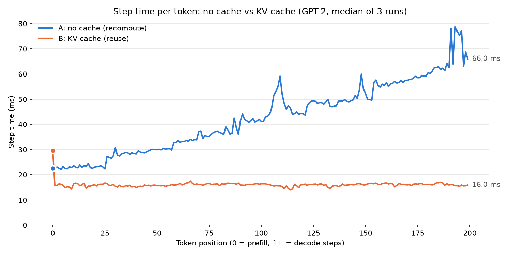
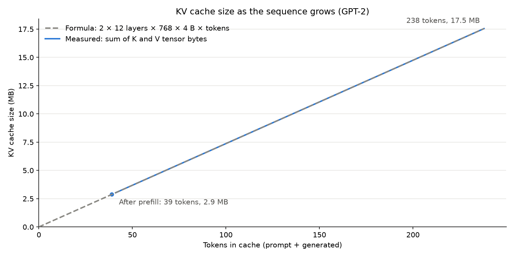

# Lab 3: KV Cache: Store Instead of Recompute

**Full write-up:** [report.pdf](report.pdf) · **Code:** [kv_cache.py](kv_cache.py)

## Goal

In Lab 1, every decode step pushed the *whole* sequence through GPT-2 again, so each step got slower as the text got longer. This lab adds a KV cache to the generation loop, checks that it makes step time flat, and measures how much memory the cache costs.

**Hypothesis:** with a cache, each step only processes the one new token, so step time should stay flat. The price is memory: the cache should grow by the same fixed amount for every token.

## What a KV cache is

Inside every attention layer, each token gets turned into a **key** (K) and a **value** (V). The keys and values of old tokens never change, so recomputing them every step (what Lab 1 did) is wasted work.

A KV cache **stores** them the first time they're computed and **reuses** them afterwards. In Hugging Face, you pass use_cache=True, the model returns past_key_values, and on the next step you pass that back in together with **only the new token**.

## Setup

| | |
|---|---|
| Model | GPT-2 small (124M params), fp32 |
| Hardware | Apple M1, MPS backend |
| Libraries | torch 2.14.1, transformers 5.20.2 |
| Decoding | Greedy, batch size 1, 39-token prompt, 200 new tokens |
| Version A | No cache: the full sequence every step, `use_cache=False` |
| Version B | KV cache: the full prompt once, then 1 token per step plus `past_key_values` |
| Timing | `torch.mps.synchronize()` before stopping each timer, 5 untimed warm-up steps of **both** loops, median of 3 runs per position |
| Validation | A and B generate **identical tokens** |

## Results

### Time



| | A: no cache | B: KV cache |
|---|---|---|
| Prefill (step 0) | 22.50 ms | 29.62 ms |
| Decode median | 42.49 ms | 16.08 ms |
| First decode step | 22.08 ms | 15.78 ms |
| Last decode step (token 200) | 65.99 ms | 15.97 ms |
| Whole generation (200 tokens) | ~8.5 s | ~3.2 s |

| Position | Tokens in sequence | Speedup (A ÷ B) |
|---|---|---|
| 1 | 40 | 1.40× |
| 50 | 89 | 1.91× |
| 100 | 139 | 2.50× |
| 150 | 189 | 3.26× |
| 199 | 238 | **4.13×** |

### Memory



Each layer stores a key tensor and a value tensor of shape **`[1, 12, seq_len, 64]`** = [batch, heads, tokens, head_dim], and 12 heads × 64 = 768 = d_model.

| Tokens in cache | Measured (sum of tensor bytes) | Formula (2 × 12 × 768 × 4 B × tokens) |
|---|---|---|
| 43 | 3,170,304 B | 3,170,304 B ✅ |
| 238 | 17,547,264 B (17.5 MB) | 17,547,264 B ✅ |
| **Per token** | **73,728 B = 72 KB** | **73,728 B** ✅ |

## Takeaways

- **Recompute vs reuse.** A's step time climbs from 22 to 66 ms because each step recomputes keys and values for every earlier token. B stays flat at ~16 ms because it reuses them and only processes the new token.
- **The speedup grows with length**, from 1.4× to 4.1× over 200 tokens. A's cost per step keeps rising and B's doesn't, so the longer the text, the bigger the win.
- **We stored instead of recomputed, and paid for it in memory:** 72 KB per token for GPT-2 in fp32. The spec's 36 KB assumes fp16 (2 bytes per number). My model runs in fp32 (4 bytes), so I get exactly double. Measured and formula match to the byte.
- **At scale, memory is the problem.** A 70B-style model (80 layers, d_model 8192, fp16) needs ~2.6 MB per token. For 32 users with 4k context that's **~344 GB of KV cache**, more than the 140 GB of weights. (With grouped-query attention, as in Llama 2 70B, it's ~43 GB.)
- **Decode is still memory-bound with a cache, even more so.** The cache removes the *compute*, not the *memory reads*. Each step is back to real decode at ~0.5 FLOP/byte, ~90× below the M1's ridge from Lab 2. B's 16 ms step reaches ~54% of the memory-bound roof (Lab 1 managed ~25%).
- **Two open questions:**
  - A's curve jumps roughly every 32 tokens. My guess is that the GPU processes the sequence in tiles of 32 rows.
  - B's prefill is ~7 ms slower than A's. My guess is the extra work of building the cache.

  Both need a profiler to confirm.

## Run

```bash
python kv_cache.py
```

Prints the timing summary, the speedup at several positions, and the measured-vs-formula cache check. It saves both plots to `results/`. Set `n_runs=1` at the top of the script for a quicker test run.
